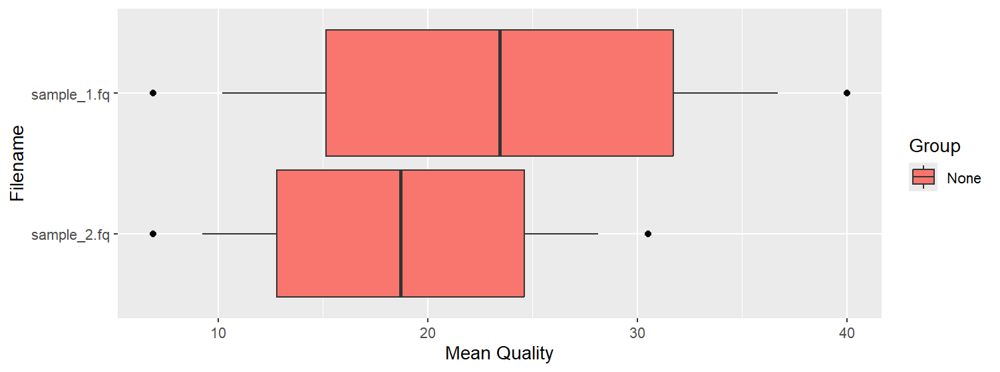

# 🧬 Introduction to Genomic Analysis with Bioconductor (R Workshop)

## 📌 About This Workshop

This workshop was organized by **Nikolaos Katsikavalis** and the **IEEE Student Branch Lamia** at the **Department of Computer Science and Biomedical Informatics, University of Thessaly**.

This repository contains the complete hands-on code, documentation, and practical workflow from the event. The primary objective was to introduce students and researchers to genomic data analysis in R using the **Bioconductor** ecosystem—covering everything from core `S4` object architecture and sequence manipulation to genomic ranges (`GRanges`), transcriptomic annotations (`TxDb`), and automated Next-Generation Sequencing (NGS) quality control (`Rqc`).

* **Speaker:** Nikolaos Katsikavalis
* **Organized by:** Nikolaos Katsikavalis & IEEE Student Branch Lamia
* **Affiliation:** Department of Computer Science and Biomedical Informatics, University of Thessaly
* **Contact:** [nkatsikavalis@uth.gr](mailto:nkatsikavalis@uth.gr) 

---

## 📂 Repository Contents

* `Bioconductor_Workshop_Script.R`: The complete, self-contained R script with all workshop modules (0 to 9).
* `Οδηγός_Workshop_Bioconductor.pdf`: Comprehensive step-by-step workshop guide and documentation (in Greek).
* `image_f1e526.png`: Per-sample FASTQ mean quality Boxplot generated during the QC module.

---

## 🚀 Quick Start & Automated Setup (Module 0)

To ensure 100% reproducibility and fast execution during the live session without downloading massive multi-gigabyte NGS files, the script automatically generates a local `data/` directory containing lightweight mock **FASTA** (`mock_virus.fa`) and **FASTQ** (`sample_1.fq`, `sample_2.fq`) files, and installs all required Bioconductor packages.

```R
if (!dir.exists("data")) dir.create("data")

# Generate mock FASTA & FASTQ files
fasta_content <- c(">seq1", "ATGCGTACGTAGCTAG", ">seq2", "CGTACGTAGCTAGCTA")
writeLines(fasta_content, "data/mock_virus.fa")

fastq1_content <- c("@SEQ1", "GATTTGGGGTTCAAAG", "+", "!''*((((***+))%%", 
                    "@SEQ2", "ATCGTACGATCGATCG", "+", "IIIIIIIIIIIIIIII")
writeLines(fastq1_content, "data/sample_1.fq")

fastq2_content <- c("@SEQ1_S2", "GATTTGGGGTTCAAAG", "+", "!''*((((***+))%%", 
                    "@SEQ2_S2", "ATCGTACGATCGATCG", "+", "IIIIIIIIIIII####")
writeLines(fastq2_content, "data/sample_2.fq")

# Install required Bioconductor packages
if (!requireNamespace("BiocManager", quietly = TRUE)) install.packages("BiocManager")
BiocManager::install(c(
  "Biostrings", 
  "GenomicRanges", 
  "Rqc", 
  "BSgenome.Scerevisiae.UCSC.sacCer3",
  "TxDb.Hsapiens.UCSC.hg38.knownGene"
), update = FALSE, ask = FALSE)
```

**Expected Output:**
```text
Δημιουργία δεδομένων...
Εγκατάσταση πακέτων (Αυτό θα πάρει λίγα λεπτά)...
Όλα έτοιμα!
```

---

## 🔬 Workshop Modules & Expected Outputs

### 1. Environment & Validity Check (`BiocManager`)
Verifies that the R environment and installed Bioconductor packages are properly synchronized.
```R
library(BiocManager)
BiocManager::version()
BiocManager::valid()
sessionInfo()
```

**Expected Output:**
```text
> BiocManager::version()
[1] '3.23'

> BiocManager::valid()
Bioconductor version '3.23'
7 packages out-of-date
0 packages too new
Warning message:
7 packages out-of-date; 0 packages too new
```

---

### 2. S4 Architecture & `S4Vectors` (`DataFrame`)
Explores Bioconductor's strict S4 class system using `DataFrame` (capital D), which safely stores complex genomic structures in predefined slots.
```R
library(S4Vectors)
df <- DataFrame(chromosome = c("chr1", "chr2"), genes = c(10, 15))
isS4(df)
showMethods(class = "DataFrame")
```

**Expected Output:**
```text
> isS4(df)
[1] TRUE

> showMethods(class = "DataFrame")
Function: [ (package base)
x="DataFrame"
Function: [[ (package base)
x="DataFrame"
Function: as.data.frame (package BiocGenerics)
x="DataFrame"
Function: cbind (package BiocGenerics)
...="DataFrame"
Function: nrow (package base)
x="DataFrame"
Function: show (package methods)
object="DataFrame"
```

---

### 3. Biological Sequence Manipulation (`Biostrings`)
Handles DNA/RNA sequences, translates codons into amino acids (`*` indicates a Stop codon), computes the 5' -> 3' reverse complement, and parses FASTA files.
```R
library(Biostrings)
dna_seq <- DNAString("ATGCGTACGTAGCTAGCTAGT")
rna_seq <- RNAString(dna_seq)
protein_seq <- translate(dna_seq)
reverseComplement(dna_seq)

fasta_reads <- readDNAStringSet("data/mock_virus.fa")
width(fasta_reads)
```

**Expected Output:**
```text
> rna_seq
21-letter RNAString object
seq: AUGCGUACGUAGCUAGCUAGU

> protein_seq
7-letter AAString object
seq: MRT*LAS

> reverseComplement(dna_seq)
21-letter DNAString object
seq: ACTAGCTAGCTACGTACGCAT

> width(fasta_reads)
[1] 16 16
```

---

### 4. Reference Genomes (`BSgenome`)
Loads the full reference genome of *Saccharomyces cerevisiae* (yeast), inspects chromosome lengths, and extracts specific genomic coordinates from the mitochondrial chromosome (`chrM`).
```R
library(BSgenome.Scerevisiae.UCSC.sacCer3)
yeast <- BSgenome.Scerevisiae.UCSC.sacCer3
seqlengths(yeast)
chrM_sub <- getSeq(yeast, names = "chrM", start = 1, end = 50)
chrM_sub
```

**Expected Output:**
```text
> seqlengths(yeast)
   chrI   chrII  chrIII   chrIV    chrV   chrVI  chrVII chrVIII   chrIX    chrX 
 230218  813184  316620 1531933  576874  270161 1090940  562643  439888  745751 
  chrXI  chrXII chrXIII  chrXIV   chrXV  chrXVI    chrM 
 666816 1078177  924431  784333 1091291  948066   85779 

> chrM_sub
50-letter DNAString object
seq: TTCATAATTAATTTTTTATATATATATTATATTATAATATTAATTTATAT
```

---

### 5. Genomic Intervals (`IRanges` & `GRanges`)
Demonstrates the difference between simple 1-based closed integer intervals (`IRanges`) and biological genomic coordinates (`GRanges`) that include chromosome (`seqnames`) and strand direction (`+` forward 5' -> 3', `-` reverse 3' -> 5').
```R
library(IRanges)
library(GenomicRanges)

ir <- IRanges(start = c(1, 100), end = c(50, 250))
gr <- GRanges(
  seqnames = c("chr1", "chr2"),
  ranges = IRanges(start = c(100, 500), end = c(300, 750)),
  strand = c("+", "-")
)
gr
```

**Expected Output:**
```text
> ir
IRanges object with 2 ranges and 0 metadata columns:
          start       end     width
      <integer> <integer> <integer>
  [1]         1        50        50
  [2]       100       250       151

> gr
GRanges object with 2 ranges and 0 metadata columns:
      seqnames    ranges strand
         <Rle> <IRanges>  <Rle>
  [1]     chr1   100-300      +
  [2]     chr2   500-750      -
-------
seqinfo: 2 sequences from an unspecified genome; no seqlengths
```

---

### 6. Spatial Interval Overlaps (`findOverlaps`)
Identifies spatial intersections between experimental regions (`query`) and reference regions (`subject`) using the 1-based closed interval formula (End = Start + Width - 1).
```R
query <- GRanges("chr1", IRanges(start = c(50, 150), width = 60))     # 50-109, 150-209
subject <- GRanges("chr1", IRanges(start = c(100, 200), width = 80))  # 100-179, 200-279

hits <- findOverlaps(query, subject)
hits
subsetByOverlaps(query, subject)
```

**Expected Output:**
```text
> hits
Hits object with 3 hits and 0 metadata columns:
      queryHits subjectHits
      <integer>   <integer>
  [1]         1           1
  [2]         2           1
  [3]         2           2
-------
queryLength: 2 / subjectLength: 2

> subsetByOverlaps(query, subject)
GRanges object with 2 ranges and 0 metadata columns:
      seqnames    ranges strand
         <Rle> <IRanges>  <Rle>
  [1]     chr1    50-109      *
  [2]     chr1   150-209      *
-------
seqinfo: 1 sequence from an unspecified genome; no seqlengths
```

---

### 7. Genome Annotations & Transcriptomes (`TxDb`)
Queries the Human Genome annotation database (`UCSC hg38`), restricts the scope to chromosome X (`chrX`), and groups exons by transcript (`tx`).
```R
library(TxDb.Hsapiens.UCSC.hg38.knownGene)
txdb <- TxDb.Hsapiens.UCSC.hg38.knownGene
seqlevels(txdb) <- "chrX"
exons_per_tx <- exonsBy(txdb, by = "tx")
exons_per_tx[1:2]
```

**Expected Output:**
```text
> exons_per_tx[1:2]
GRangesList object of length 2:
$`372516`
GRanges object with 2 ranges and 3 metadata columns:
      seqnames        ranges strand |   exon_id   exon_name exon_rank
         <Rle>     <IRanges>  <Rle> | <integer> <character> <integer>
  [1]     chrX 253743-253846      + |    864905        <NA>         1
  [2]     chrX 254937-255091      + |    864906        <NA>         2
-------
seqinfo: 1 sequence from hg38 genome

$`372517`
GRanges object with 8 ranges and 3 metadata columns:
      seqnames        ranges strand |   exon_id   exon_name exon_rank
         <Rle>     <IRanges>  <Rle> | <integer> <character> <integer>
  [1]     chrX 276322-276394      + |    864907        <NA>         1
  [2]     chrX 281482-281684      + |    864913        <NA>         2
  [3]     chrX 284167-284314      + |    864918        <NA>         3
  [4]     chrX 288733-288869      + |    864921        <NA>         4
  [5]     chrX 290648-290776      + |    864923        <NA>         5
  [6]     chrX 291499-291654      + |    864928        <NA>         6
  [7]     chrX 293035-293218      + |    864929        <NA>         7
  [8]     chrX 299097-303353      + |    864930        <NA>         8
-------
seqinfo: 1 sequence from hg38 genome
```

---

### 8. Reading & Filtering NGS Reads (`ShortRead`)
Parses raw FASTQ sequencing files, inspects DNA sequences (`sread`) and ASCII-encoded Phred quality scores (`quality`), and applies a custom minimum length filter (>= 16 sequencing cycles/bases).
```R
library(ShortRead)
fq <- readFastq("data/sample_1.fq")
sread(fq)
quality(fq)

len_filter <- srFilter(function(x) width(x) >= 16, name = "MinLength16")
fq_filtered <- fq[len_filter(fq)]
length(fq_filtered)
```

**Expected Output:**
```text
> sread(fq)
DNAStringSet object of length 2:
    width seq
[1]    16 GATTTGGGGTTCAAAG
[2]    16 ATCGTACGATCGATCG

> quality(fq)
class: FastqQuality
quality:
BStringSet object of length 2:
    width seq
[1]    16 !''*((((***+))%%
[2]    16 IIIIIIIIIIIIIIII

> fq_filtered
class: ShortReadQ
length: 2 reads; width: 16 cycles

> length(fq_filtered)
[1] 2
```

---

### 9. Automated FASTQ Quality Control (`Rqc`)
Performs batch quality control across all `.fq` files in the `data/` directory and visualizes the per-sample mean quality distribution using a Boxplot.
```R
library(Rqc)
qc_results <- rqc(path = "data", pattern = ".fq$", sample = TRUE)
rqcReadQualityBoxPlot(qc_results)
```

**Expected Output:**
```text
'C:\Users\...\AppData\Local\Temp\...\rqc_report.html' has been created.
```

#### 📊 Quality Control Visualization (Boxplot)


* **`sample_1.fq`:** Exhibits higher overall read quality (median around **Q24**, reaching up to **Q40** for `I` bases), with wider variance due to lower quality scores in the initial bases of the first read (`!''*`).
* **`sample_2.fq`:** Shows a lower quality distribution (median around **Q19**), directly reflecting the sharp quality drop at the 3' tail of the second read (`####`).
